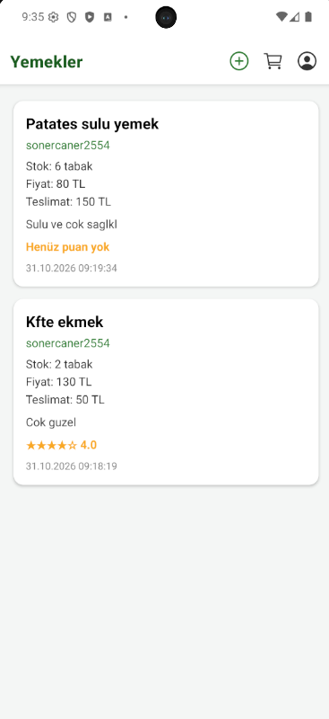
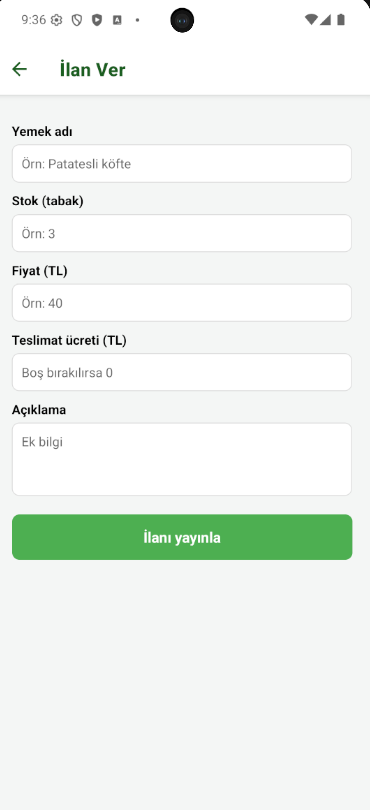
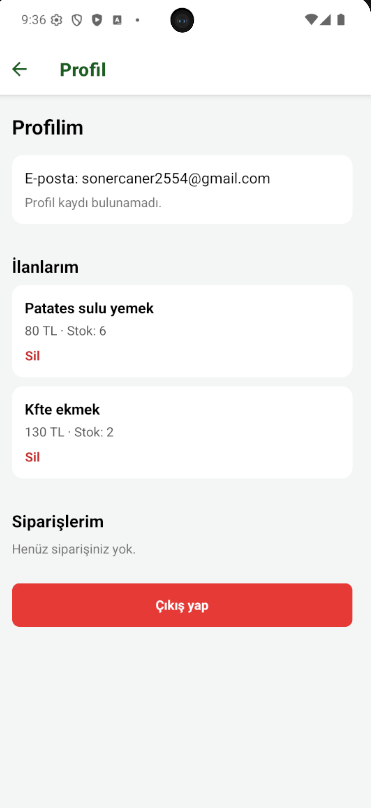
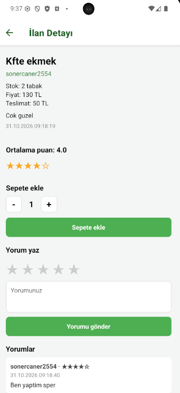
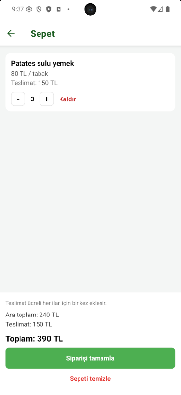

<div align="center">

# KomsuYemek 🍲

**Homemade food, closer to home.**

A community-focused mobile app concept connecting home cooks with neighbors and busy people looking for homemade meals.

   

</div>

## About the project

KomsuYemek aims to make homemade meals more accessible while helping people who enjoy cooking earn extra income. Home cooks can share their dishes with neighbors and people who may not have the time or opportunity to prepare home-cooked food.

The project is currently a **prototype**, not a production-ready food ordering service.

## Confirmed features

- **User authentication:** Sign-up and sign-in flows.
- **Meal listings:** Create listings with a meal name, available portions, price, delivery fee, and description.
- **Meal discovery:** Browse available meal listings and see basic information such as price and stock.
- **User profile:** Access a personal profile area and view your own listings.

### Additional interfaces shown in the prototype

The current screenshots also show meal details, ratings and comments, a shopping cart, and an order submission interface. Their end-to-end behavior has **not yet been verified**, so they are not listed above as completed features.

## Screenshots

These screenshots show the current Android prototype. Sample listing content and account details are for demonstration purposes.

| Meal discovery | Create a listing | Profile |
|:---:|:---:|:---:|
|  |  |  |

| Meal details | Cart |
|:---:|:---:|
|  |  |

## Tech stack

- **Mobile:** React Native, Expo (SDK 52)
- **Language:** JavaScript
- **Backend services:** Firebase
- **Navigation:** React Navigation
- **Media selection dependency:** Expo Image Picker

> The exact Firebase services, configuration variables, and supported authentication providers should be checked against the current source code before documenting them in detail.

## Getting started

### Prerequisites

- Node.js and npm
- A compatible Android emulator or physical device
- An Expo development environment

### Local setup

```bash
# Clone the repository
git clone https://github.com/sonersimsekk/KomsuYemek.git
cd KomsuYemek

# Install dependencies
npm install

# Start Expo
npx expo start
```

If your environment supports it, press `a` in the Expo terminal to open the Android app. Depending on the project's native dependencies, a development build may be required instead of Expo Go.

**Firebase configuration:** This project uses Firebase. The exact setup steps have not yet been documented. Configure the required Firebase project settings before attempting authenticated or database-backed flows. Never commit service-account credentials, private keys, or other secrets.

> This is an older Expo SDK 52 project. Dependency compatibility and startup should be verified in the current development environment.

## Roadmap

Potential future improvements include:

- [ ] In-app messaging between buyers and home cooks
- [ ] Favorite meals and saved listings
- [ ] User verification and trust features
- [ ] Improved ratings and reviews, including purchase verification
- [ ] Order lifecycle and status tracking
- [ ] Search, filtering, and location-aware discovery
- [ ] Notifications for orders and messages
- [ ] Stronger privacy, security, and content moderation controls

These are **ideas and planned improvements**, not claims of implemented functionality.

## Project status

**Prototype / work in progress.** Core authentication, listing creation, browsing, and profile features are available according to the current development assessment. Other screens and workflows require further testing before being described as complete.

## Developer

**Soner Şimşek**

- [GitHub](https://github.com/sonersimsekk)
- [GitLab](https://gitlab.com/sonersimsek)
- [LinkedIn](https://www.linkedin.com/in/sonersimsekk1)

---

<div align="center"><sub>Built to bring homemade food and local communities closer together.</sub></div>
